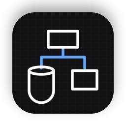
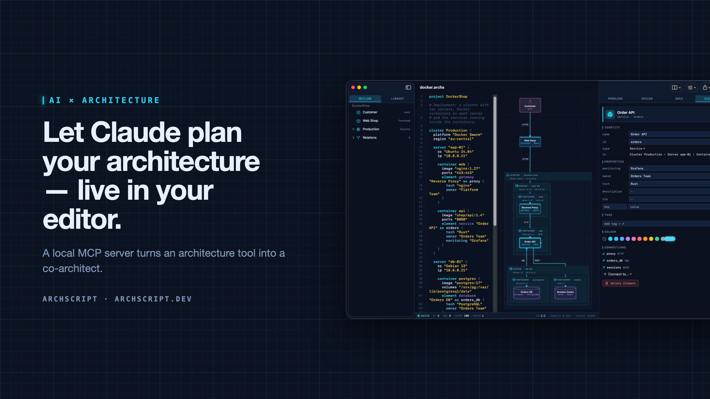
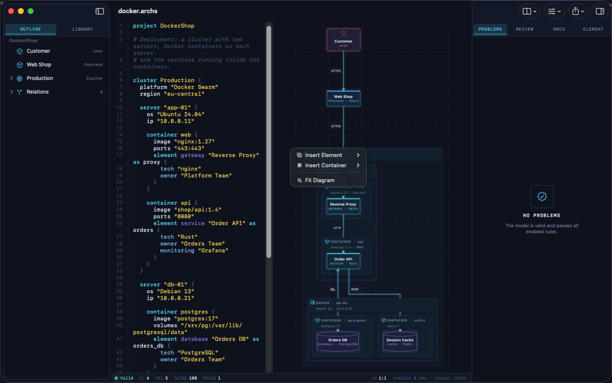
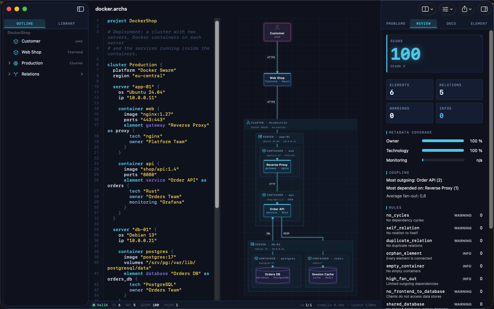
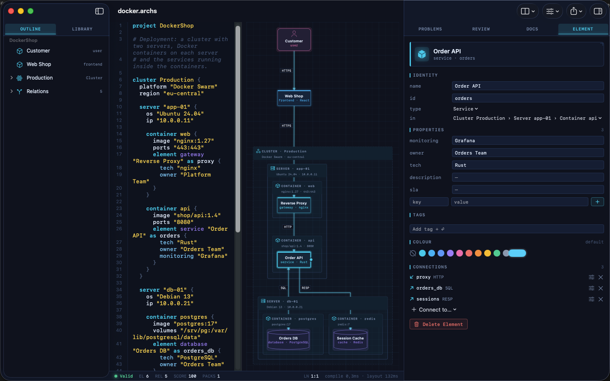
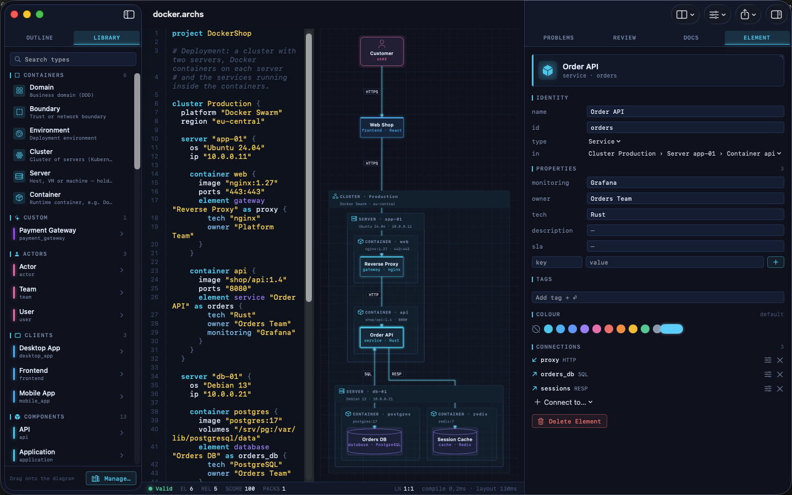
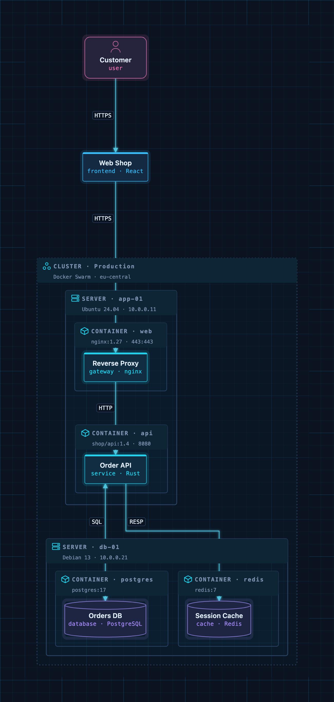

<p align="center">
  
</p>

<h1 align="center">ArchScript MCP</h1>

<p align="center">
  <b>Let Claude plan, edit and review your software architecture — live in ArchScript for Mac.</b><br>
  Architecture as code · live diagram · architecture rules · local-only MCP server
</p>

<p align="center">
  <a href="https://archscript.dev/?ref=github">Website</a> ·
  <a href="https://archscript.dev/playground/?ref=github">Playground</a> ·
  <a href="https://archscript.dev/guides/ai-assistants/?ref=github">Setup guide</a> ·
  <a href="https://archscript.dev/docs/?ref=github">Language docs</a> ·
  <a href="https://archscript.dev/templates/?ref=github">Templates</a>
</p>

---



**ArchScript** is an architecture-as-code tool. You describe a system — domains,
services, databases, queues, and deployments as cluster → server → Docker
container — in a small language. ArchScript draws the diagram, checks the model
against architecture rules and exports documentation, a PDF report, Mermaid,
PlantUML and Terraform.

**ArchScript for Mac** includes an [MCP](https://modelcontextprotocol.io) server.
Claude Desktop, Claude Code and other MCP clients can read the architectures you
have open, change them with precise, structured edits, validate them and look at
the rendered diagram. Every change appears live in the window and can be undone.

> This repository contains the documentation, configuration examples and example
> models for the ArchScript MCP server. ArchScript itself is a closed-source app,
> available on the Mac App Store. The browser Playground is free.

## What Claude can do

| Tool | What it does |
| --- | --- |
| `archscript_guide` | Learns the language, element types and rules |
| `list_documents` | Lists the open documents (id, name, validity) |
| `get_document` | Reads a document with line numbers and a structure outline |
| `create_document` | Creates a new architecture from ArchScript source |
| `set_document_source` | Replaces a document's source |
| `edit_document` | Structured edits: add, rename, move and delete elements, relations and containers, and set properties, tags and colours |
| `validate` | Returns diagnostics |
| `review` | Returns the review score, grade and rule findings |
| `render_diagram` | Returns the diagram as an image, so the assistant can see the result |
| `export` | Exports Mermaid, PlantUML, Markdown, JSON or Terraform |

The assistant doesn't rewrite your file. It sends small operations (for example
`add_element` into `cluster:Production/server:app-01/container:api`). The
ArchScript core turns those into minimal text edits, so comments and formatting
stay intact. After each change the assistant gets the validation result and
review score back, the same feedback loop a human architect uses.

### Example prompts

- *"Read my architecture and tell me which rules it violates."*
- *"Add a background worker that sends order emails. Put it in its own container on app-01 and connect the Order API to it."*
- *"Create an event-driven architecture for a ticket shop with a payment provider and a read model."*
- *"Export the current model as Terraform for AWS and list what wasn't mapped."*

## Setup

Requirements: **ArchScript for Mac** (macOS 14+) with **ArchScript Pro**
(14-day free trial).

1. Open **ArchScript → Settings → AI** and turn on **Allow AI assistants (MCP)**.
2. Copy the snippet for your client from that screen. It already contains your
   personal access token.

### Claude Desktop: one-click install (recommended)

1. Download **[archscript.mcpb](https://github.com/schlummer13/archscript-mcp/releases/latest/download/archscript.mcpb)** from the latest release.
2. Double-click it, or drag it into Claude Desktop → Settings → Extensions.
3. Paste the access token from ArchScript → Settings → AI.

The extension contains no ArchScript code. It holds a manifest and a small
launcher script ([`mcpb/server/archscript-mcp`](mcpb/server/archscript-mcp))
that finds ArchScript for Mac and starts its bundled helper.

### Claude Code

```bash
claude mcp add --transport http archscript http://127.0.0.1:47621/mcp \
  --header "Authorization: Bearer <token from Settings → AI>"
```

### Claude Desktop (manual)

Add the snippet to `claude_desktop_config.json`, then restart Claude:

```json
{
  "mcpServers": {
    "archscript": {
      "command": "/Applications/ArchScript.app/Contents/MacOS/archscript-mcp",
      "args": ["--token", "<token from Settings → AI>", "--port", "47621"]
    }
  }
}
```

The bundled `archscript-mcp` helper bridges stdio to the app and starts
ArchScript when Claude needs it.

### Other MCP clients

Any client that supports **Streamable HTTP** can connect to
`http://127.0.0.1:47621/mcp` with the header `Authorization: Bearer <token>`.
Clients that only support stdio can use the helper as shown above.

## Privacy and security

- **Local only.** The server listens on `127.0.0.1` and is never reachable from the network.
- **Token required.** Every request needs your access token. You can regenerate it at any time in Settings → AI.
- **Off by default.** Nothing runs until you turn it on.
- **No telemetry.** ArchScript collects no data and sends nothing anywhere. Your AI client only sees what it reads through the tools.
- The helper is sandboxed and only forwards stdio to the local server.

## Screenshots

| Visual editing | Review and rules |
| --- | --- |
|  |  |
| **Inspector** | **Element library** |
|  |  |

A Docker deployment as code: cluster → servers → containers → services.



## Example models

The [`examples/`](examples) folder contains ready-to-use architectures. Open one
in ArchScript for Mac, or paste it into the
[Playground](https://archscript.dev/playground/?ref=github):

| File | Architecture |
| --- | --- |
| [`basic.archs`](examples/basic.archs) | The smallest useful model |
| [`customer-management.archs`](examples/customer-management.archs) | One domain with web app, API and database |
| [`webapp.archs`](examples/webapp.archs) | Classic web application with boundaries |
| [`microservices.archs`](examples/microservices.archs) | Services with their own databases and an event bus |
| [`ddd.archs`](examples/ddd.archs) | Bounded contexts (domain-driven design) |
| [`event.archs`](examples/event.archs) | Event-driven, CQRS-style flow |
| [`saas.archs`](examples/saas.archs) | Production SaaS with gateway and identity provider |
| [`docker.archs`](examples/docker.archs) | Docker Swarm cluster, servers and containers |

A taste of the language:

```archscript
project DockerShop

cluster Production {
  platform "Docker Swarm"

  server "app-01" {
    container api {
      image "shop/api:1.4"
      element service "Order API" as orders { tech "Rust"; owner "Orders Team" }
    }
  }
}

element frontend "Web Shop" as shop
relation shop -> orders : HTTPS
```

The full language reference is at
[archscript.dev/docs](https://archscript.dev/docs/?ref=github).

## Feedback

Found a bug in the MCP integration or have an idea for a tool? Please
[open an issue](../../issues). Feature requests for ArchScript itself are
welcome too.

## License

The documentation, configuration snippets and example models in this repository
are available under the [MIT License](LICENSE). ArchScript for Mac and the
ArchScript core are proprietary software.
